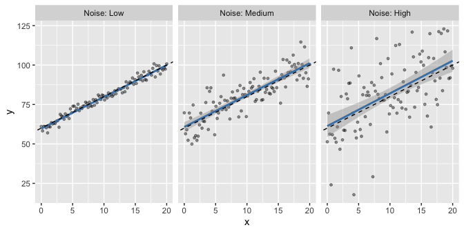
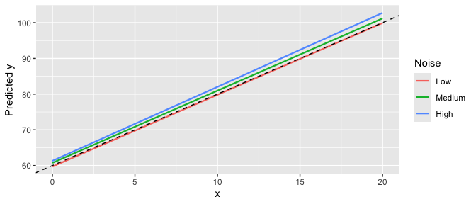
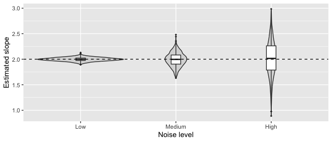
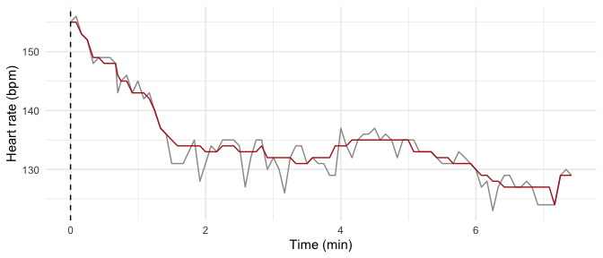
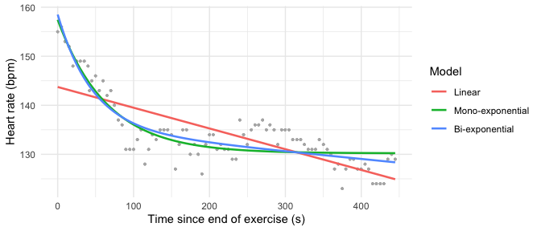
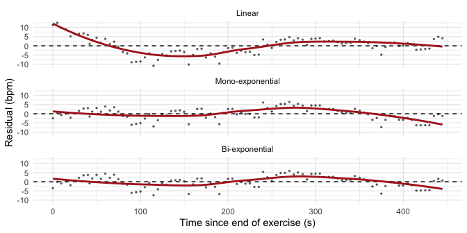
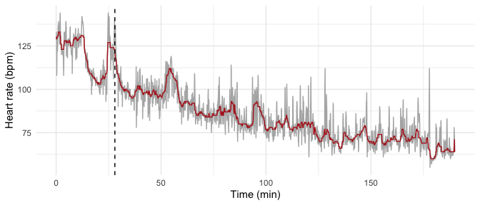
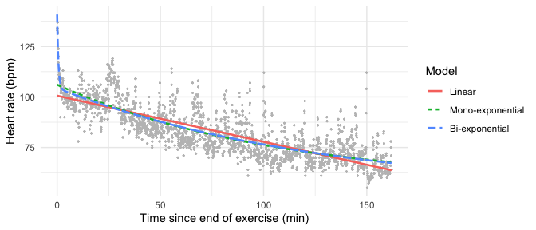
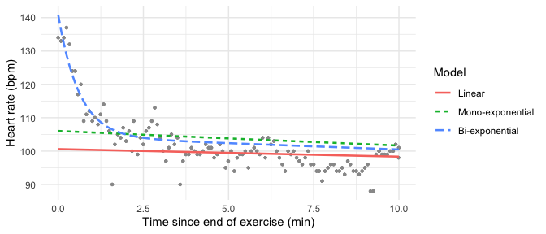
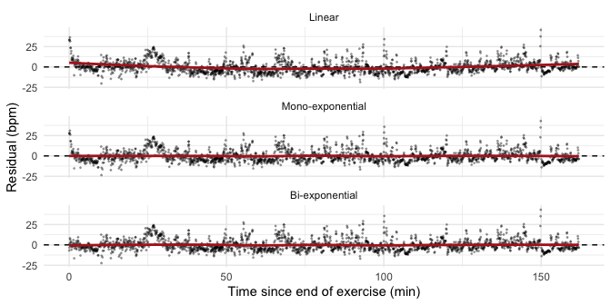

# IEAP Series 04 – Linear and non-linear regressions
Martin Pigeau, Chloé Gilles, Isah Dadiga
2026-11-06

GitHub repository:
<https://github.com/ChloeGil-student/IEAP-Series04-RStudio>

# How does random noise affect linear regression?

``` r
library(ggplot2)
library(knitr)
```

## Expectations

Before running any simulation, we formulated the following expectations.
The model is $y = \beta_0 + \beta_1 x + \varepsilon$ with
$\varepsilon \sim \mathcal{N}(0, \sigma^2)$, and only $\sigma$ changes
between the three datasets.

- **Slope and intercept.** Ordinary least squares estimators are
  unbiased whatever the noise level: on average, the estimated slope and
  intercept should be equal to the true values. However, their variance
  increases with $\sigma^2$ (the standard error of the slope is
  $\sigma / \sqrt{\sum (x_i - \bar{x})^2}$). With a single dataset per
  noise level, we therefore expect the estimates to move further away
  from the true values, in a random direction, when the noise increases,
  and their confidence intervals to become wider.
- **Quality of the predictions.** The residual error (RMSE) should be
  close to $\sigma$, so it should increase roughly in proportion to the
  noise. Confidence and prediction intervals around the fitted line
  should widen.
- **Explained variance.** Since the variance explained by $x$ stays the
  same while the residual variance increases, $R^2$ should decrease
  strongly: the expected value is approximately
  $\beta_1^2 \mathrm{Var}(x) / (\beta_1^2 \mathrm{Var}(x) + \sigma^2)$.
- **Identical relationships?** The underlying relationship is identical,
  but the *estimated* lines will not be: they should all be close to the
  true line, the noisiest one being the most likely to deviate from it.

## Simulation of three datasets

The three datasets share the same true relationship ($\beta_0 = 60$,
$\beta_1 = 2$), the same `x` values (100 equally spaced values between 0
and 20) and differ only by the standard deviation of the Gaussian noise.

``` r
set.seed(2026)
n      <- 100
beta0  <- 60
beta1  <- 2
x      <- seq(0, 20, length.out = n)
sigmas <- c(Low = 2, Medium = 8, High = 20)

noise_data <- do.call(rbind, lapply(names(sigmas), function(lv)
  data.frame(Noise = lv, sigma = sigmas[[lv]], x = x,
             y = beta0 + beta1 * x + rnorm(n, mean = 0, sd = sigmas[[lv]]))))
noise_data$Noise <- factor(noise_data$Noise, levels = names(sigmas))

# Theoretical R² for each noise level
r2_theory <- beta1^2 * var(x) / (beta1^2 * var(x) + sigmas^2)
```

## Fitting the linear models

``` r
noise_fits <- lapply(split(noise_data, noise_data$Noise), function(d) lm(y ~ x, data = d))

noise_table <- do.call(rbind, lapply(names(noise_fits), function(lv) {
  m  <- noise_fits[[lv]]
  s  <- summary(m)
  ci <- confint(m)
  data.frame(Noise = lv, sigma = sigmas[[lv]],
             Intercept = coef(m)[[1]], Slope = coef(m)[[2]],
             SE_slope = s$coefficients[2, 2],
             CI95_slope = sprintf("[%.2f; %.2f]", ci[2, 1], ci[2, 2]),
             R2 = s$r.squared, R2_theory = r2_theory[[lv]],
             RMSE = sqrt(mean(residuals(m)^2)))
}))
```

## Comparison of the three models

``` r
kable(noise_table, digits = 3, row.names = FALSE)
```

<div id="tbl-noise">

Table 1: Linear regression fitted to each dataset (true values:
intercept = 60, slope = 2).

<div class="cell-output-display">

| Noise  | sigma | Intercept | Slope | SE_slope | CI95_slope     |    R2 | R2_theory |   RMSE |
|:-------|------:|----------:|------:|---------:|:---------------|------:|----------:|-------:|
| Low    |     2 |    59.699 | 2.010 |    0.035 | \[1.94; 2.08\] | 0.972 |     0.972 |  1.995 |
| Medium |     8 |    60.746 | 2.023 |    0.132 | \[1.76; 2.28\] | 0.705 |     0.682 |  7.623 |
| High   |    20 |    61.309 | 2.072 |    0.304 | \[1.47; 2.68\] | 0.321 |     0.256 | 17.558 |

</div>

</div>

``` r
ggplot(noise_data, aes(x, y)) +
  geom_point(alpha = 0.4, size = 1) +
  geom_smooth(method = "lm", formula = y ~ x, colour = "steelblue") +
  geom_abline(intercept = beta0, slope = beta1, linetype = "dashed") +
  facet_wrap(~ Noise, labeller = label_both) +
  labs(x = "x", y = "y")
```

<div id="fig-noise-fit">



Figure 1: Simulated data and fitted regression lines (solid, with 95%
confidence band). The dashed line is the true relationship.

</div>

``` r
pred <- do.call(rbind, lapply(names(noise_fits), function(lv)
  data.frame(Noise = lv, x = x, y = predict(noise_fits[[lv]]))))
pred$Noise <- factor(pred$Noise, levels = names(sigmas))
ggplot(pred, aes(x, y, colour = Noise)) +
  geom_line(linewidth = 0.8) +
  geom_abline(intercept = beta0, slope = beta1, linetype = "dashed") +
  labs(x = "x", y = "Predicted y")
```

<div id="fig-noise-lines">



Figure 2: The three fitted lines compared with the true relationship
(black, dashed).

</div>

<a href="#tbl-noise" class="quarto-xref">Table 1</a> shows that the
estimated slopes are 2.01, 2.02, 2.07 for the low, medium and high noise
levels (true value: 2), and the standard error of the slope increases
from 0.035 to 0.304. The RMSE (2.0, 7.6, 17.6) is close to the true
noise level (2, 8, 20), and $R^2$ drops from 0.97 to 0.32, close to its
theoretical values (0.97, 0.68, 0.26).

## Conclusions

Our expectations were confirmed on the points that do not depend on
chance: the RMSE increased with the noise level and stayed close to
$\sigma$, $R^2$ decreased strongly, and the uncertainty of the estimates
(standard errors, width of the confidence intervals and of the
confidence band in
<a href="#fig-noise-fit" class="quarto-xref">Figure 1</a>) increased.
The three fitted lines are not identical
(<a href="#fig-noise-lines" class="quarto-xref">Figure 2</a>): the more
noise, the further the estimated line *can* be from the true one.

However, with only one dataset per noise level, the error of a given
estimate is random. In our simulation the absolute error of the slope
was 0.010, 0.023, 0.072 for the three noise levels: a single realisation
does not allow us to show that the estimates are unbiased, nor to
measure precisely how their variability grows with the noise. Our main
conclusion is that random noise does not bias the regression estimates,
but it reduces their precision and the predictive performance of the
model, and makes the explained variance a poor indicator of whether the
underlying relationship is the same.

## A better numerical experiment

To reproduce the theoretical expectations, the experiment must be
repeated many times (Monte Carlo simulation): for each noise level we
simulate many datasets, fit a model to each, and study the
*distribution* of the estimates. Other improvements are to use more
noise levels (to see how the standard error grows with $\sigma$), to
vary the sample size and the spread of `x`, and to check that the 95%
confidence intervals contain the true slope in about 95% of the
simulations. We implemented the first and last points:

``` r
set.seed(42)
n_rep <- 1000
sxx <- sum((x - mean(x))^2)

mc <- do.call(rbind, lapply(names(sigmas), function(lv) {
  est <- t(replicate(n_rep, {
    y  <- beta0 + beta1 * x + rnorm(n, 0, sigmas[[lv]])
    m  <- lm(y ~ x)
    ci <- confint(m)[2, ]
    c(intercept = coef(m)[[1]], slope = coef(m)[[2]],
      r2 = summary(m)$r.squared, covered = ci[[1]] <= beta1 & beta1 <= ci[[2]])
  }))
  data.frame(Noise = lv, est)
}))
mc$Noise <- factor(mc$Noise, levels = names(sigmas))

mc_table <- do.call(rbind, lapply(split(mc, mc$Noise), function(d) {
  s <- sigmas[[as.character(d$Noise[1])]]
  data.frame(Noise = d$Noise[1], Mean_slope = mean(d$slope), SD_slope = sd(d$slope),
             SE_theory = s / sqrt(sxx), Mean_R2 = mean(d$r2),
             CI_coverage = mean(d$covered))
}))
```

``` r
kable(mc_table, digits = 3, row.names = FALSE)
```

<div id="tbl-noise-mc">

Table 2: Monte Carlo simulation (1000 datasets per noise level).

<div class="cell-output-display">

| Noise  | Mean_slope | SD_slope | SE_theory | Mean_R2 | CI_coverage |
|:-------|-----------:|---------:|----------:|--------:|------------:|
| Low    |      1.999 |    0.035 |     0.034 |   0.972 |       0.943 |
| Medium |      1.995 |    0.136 |     0.137 |   0.682 |       0.952 |
| High   |      2.016 |    0.348 |     0.343 |   0.263 |       0.946 |

</div>

</div>

``` r
ggplot(mc, aes(Noise, slope)) +
  geom_violin(fill = "grey85") +
  geom_boxplot(width = 0.1, outlier.size = 0.5) +
  geom_hline(yintercept = beta1, linetype = "dashed") +
  labs(x = "Noise level", y = "Estimated slope")
```

<div id="fig-noise-mc">



Figure 3: Distribution of the estimated slope over 1000 simulations per
noise level. Dashed line: true slope.

</div>

With 1000 repetitions, the mean slope is 1.999, 1.995, 2.016:
practically equal to 2 whatever the noise, which shows that the
estimator is unbiased. Its standard deviation (0.035, 0.136, 0.348)
matches the theoretical standard error (0.034, 0.137, 0.343), so it
grows proportionally to $\sigma$, and the confidence intervals contain
the true slope in about 95% of the cases (94.3%, 95.2%, 94.6%). This
repeated experiment reproduces the theory much better than a single
dataset per noise level.

# Heart rate recovery after exercise: predictions from the literature

## Physiological mechanisms

The decrease of HR after exercise results from changes in the autonomic
control of the heart (Peçanha et al., 2014). Two mechanisms act with
different time courses:

- **Parasympathetic (vagal) reactivation** mainly drives the early, fast
  decrease of HR. It is triggered by the deactivation of central command
  and of the mechanoreflex as soon as the exercise stops (Imai et al.,
  1994; Peçanha et al., 2014).
- **Sympathetic withdrawal** mainly drives the later, slow decrease of
  HR. It is linked to the progressive deactivation of the metaboreflex
  and of thermoregulatory mechanisms (Peçanha et al., 2014).

These pathways are impaired in cardiovascular diseases, which explains
the slower recovery observed in these patients and its association with
mortality (Cole et al., 1999; Peçanha et al., 2014).

## Expected characteristics of the recovery curve

From the literature, the recovery curve should show:

- **A fast initial decrease** during the first tens of seconds, related
  to vagal reactivation, which is the period described by T30 (Imai et
  al., 1994).
- **A slower decrease** afterwards, related to sympathetic withdrawal
  (Peçanha et al., 2014).
- **A progressive flattening** of the curve towards an asymptotic value,
  $\mathrm{HR}_\infty$, rather than a constant rate of decrease.
- **A dependence on exercise intensity**: after maximal exercise, the
  time constant of a mono-exponential fit is unstable and only
  stabilises after about 3 minutes of recording (Pierpont et al., 2000).

## Is one model sufficient for the whole recovery?

The literature suggests that a single mono-exponential model is not
always sufficient. HRR has been described as an exponential curve with a
fast and a slow decay component (Peçanha et al., 2014). A first-order
exponential decay was found adequate after submaximal exercise but
inadequate after maximal exercise, with non-random residuals (Pierpont
et al., 2000). After maximal exercise, a double-exponential model fitted
the recovery better than a single exponential in 22 of 36 participants,
with a short time constant ($\tau_1 \approx 44$ s) and a longer one
($\tau_2 \approx 120$ s) (Joseph et al., 2023). The choice of model
therefore depends on the exercise intensity and on the duration of the
recorded recovery.

## Our hypotheses

Based on this literature, we formulate the following hypotheses for the
two recordings:

- **H1:** The linear model will give the poorest fit, with structured
  (curved) residuals, because the decrease of HR is not constant over
  time.
- **H2:** On the 7.5-minute recording, a mono-exponential model may be
  sufficient if the preceding exercise was submaximal, but its residuals
  may remain structured if the exercise was close to maximal (Pierpont
  et al., 2000).
- **H3:** On the 3-hour recording, a bi-exponential model will describe
  the recovery better than a mono-exponential model, with a fast
  component (time constant of tens of seconds) and a slow component
  (time constant of minutes), reflecting vagal reactivation and
  sympathetic withdrawal (Joseph et al., 2023; Peçanha et al., 2014).
- **H4:** The added complexity of the bi-exponential model will only be
  justified if it clearly improves the fit and removes the structure of
  the residuals.

# Heart rate recovery: 7.5-minute recording

``` r
library(ggplot2)
library(knitr)
```

## Data import and exploration

The recording is downloaded from the public Aidlab datasets
(<https://www.aidlab.com/datasets>) into a `data/` folder, which is
ignored by Git.

``` r
url_short <- "https://aidlab-production-datasets.s3.eu-central-1.amazonaws.com/datasets_2026-09-27_cardio_recovery_7m30s.zip"
dir.create("data", showWarnings = FALSE)
zip_short <- "data/cardio_recovery_7m30s.zip"
if (!file.exists(zip_short)) download.file(url_short, zip_short, mode = "wb")
unzip(zip_short, exdir = "data/cardio_recovery_7m30s")

files_short <- list.files("data/cardio_recovery_7m30s", pattern = "\\.csv$",
                          recursive = TRUE, full.names = TRUE)
files_short
```

    [1] "data/cardio_recovery_7m30s/acceleration.csv" 
    [2] "data/cardio_recovery_7m30s/body-position.csv"
    [3] "data/cardio_recovery_7m30s/ecg.csv"          
    [4] "data/cardio_recovery_7m30s/pulse.csv"        
    [5] "data/cardio_recovery_7m30s/respiration.csv"  
    [6] "data/cardio_recovery_7m30s/rr.csv"           

``` r
# pulse.csv: heart rate in bpm; timestamps in Unix milliseconds (see README.txt)
raw_short <- read.csv("data/cardio_recovery_7m30s/pulse.csv")
head(raw_short)
```

         timestamp value
    1 1.790503e+12   155
    2 1.790503e+12   156
    3 1.790503e+12   153
    4 1.790503e+12   152
    5 1.790503e+12   148
    6 1.790503e+12   149

``` r
time_col  <- "timestamp"   # name of the time column
hr_col    <- "value"       # name of the heart rate column
time_unit <- 1000          # timestamps are in milliseconds

short <- data.frame(time_s = raw_short[[time_col]] / time_unit,
                    hr     = raw_short[[hr_col]])
short$time_s <- short$time_s - min(short$time_s)
# remove missing and impossible values
short <- short[!is.na(short$hr) & short$hr > 30 & short$hr < 230, ]
```

The recording contains 91 heart rate values over 7.4 minutes.

## Identification of the recovery period

The end of exercise is defined as the maximum of the heart rate smoothed
with a running median (15 values), so that an isolated artefact cannot
be selected as the peak. The recovery period goes from this peak to the
end of the recording, and time is counted from the peak.

``` r
short$hr_smooth <- as.numeric(runmed(short$hr, k = 15))
i_peak_short  <- which.max(short$hr_smooth)
t_peak_short  <- short$time_s[i_peak_short]
hr_peak_short <- short$hr_smooth[i_peak_short]

rec_short   <- short[short$time_s >= t_peak_short, ]
rec_short$t <- rec_short$time_s - t_peak_short

# Classical indices from the literature
hrr60_short <- hr_peak_short - mean(rec_short$hr[rec_short$t >= 55 & rec_short$t <= 65])
t30_short   <- -1 / coef(lm(log(hr) ~ t, data = rec_short[rec_short$t <= 30, ]))[["t"]]
```

``` r
ggplot(short, aes(time_s / 60, hr)) +
  geom_line(colour = "grey60") +
  geom_line(aes(y = hr_smooth), colour = "firebrick") +
  geom_vline(xintercept = t_peak_short / 60, linetype = "dashed") +
  labs(x = "Time (min)", y = "Heart rate (bpm)") +
  theme_minimal()
```

<div id="fig-hrr-short-raw">



Figure 4: Heart rate during the 7.5-minute recording (grey: raw values,
red: smoothed). The dashed line marks the detected end of exercise.

</div>

The peak is reached at t = 0 s (HR = 155 bpm) and the recovery lasts 7.4
min. For comparison with the literature, HRR60 = 10 bpm (Cole et al.,
1999). T30 (Imai et al., 1994) could not be estimated reliably here (573
s): heart rate is only sampled about every 5 s and the recording starts
when recovery has already begun, so the first 30 s contain very few
points.

## Model fitting

The linear model is fitted with `lm()`, and the exponential models with
`nls()` (algorithm “port”, which allows us to force the amplitudes and
time constants to be positive). The starting values are taken from the
data: the asymptote from the mean of the last 30 values, the amplitude
from the difference with the peak.

``` r
hr_end_short <- mean(tail(rec_short$hr, 30))
amp_short    <- hr_peak_short - hr_end_short

# 1. Linear
short_lin <- lm(hr ~ t, data = rec_short)

# 2. Mono-exponential
short_mono <- nls(hr ~ hr_inf + delta * exp(-t / tau),
                  data = rec_short,
                  start = list(hr_inf = hr_end_short, delta = amp_short, tau = 60),
                  algorithm = "port", lower = c(0, 0, 1))

# 3. Bi-exponential (fast + slow phase); NULL if it does not converge
short_bi <- tryCatch(
  nls(hr ~ hr_inf + d1 * exp(-t / tau1) + d2 * exp(-t / tau2),
      data = rec_short,
      start = list(hr_inf = hr_end_short, d1 = 0.6 * amp_short, tau1 = 30,
                   d2 = 0.4 * amp_short, tau2 = 300),
      algorithm = "port", lower = c(0, 0, 1, 0, 1)),
  error = function(e) NULL)

short_models <- Filter(Negate(is.null),
                       list(Linear = short_lin, `Mono-exponential` = short_mono,
                            `Bi-exponential` = short_bi))
```

``` r
short_par <- do.call(rbind, lapply(names(short_models), function(nm) {
  s <- summary(short_models[[nm]])$coefficients
  data.frame(Model = nm, Parameter = rownames(s), Estimate = s[, 1], SE = s[, 2])
}))
kable(short_par, digits = 2, row.names = FALSE)
```

<div id="tbl-hrr-short-par">

Table 3: Fitted parameters (7.5-minute recording). Time constants in
seconds, heart rate in bpm.

<div class="cell-output-display">

| Model            | Parameter   | Estimate |        SE |
|:-----------------|:------------|---------:|----------:|
| Linear           | (Intercept) |   143.73 |      0.98 |
| Linear           | t           |    -0.04 |      0.00 |
| Mono-exponential | hr_inf      |   130.21 |      0.53 |
| Mono-exponential | delta       |    27.24 |      1.70 |
| Mono-exponential | tau         |    65.00 |      7.66 |
| Bi-exponential   | hr_inf      |     0.00 |  10020.51 |
| Bi-exponential   | d1          |    23.15 |      6.48 |
| Bi-exponential   | tau1        |    45.43 |     18.22 |
| Bi-exponential   | d2          |   135.35 |  10013.75 |
| Bi-exponential   | tau2        |  8388.69 | 644616.95 |

</div>

</div>

``` r
short_pred <- do.call(rbind, lapply(names(short_models), function(nm)
  data.frame(t = rec_short$t, hr = rec_short$hr,
             fitted = as.numeric(fitted(short_models[[nm]])),
             residual = as.numeric(residuals(short_models[[nm]])), Model = nm)))
short_pred$Model <- factor(short_pred$Model, levels = names(short_models))

ggplot(short_pred, aes(t, hr)) +
  geom_point(colour = "grey70", size = 0.6) +
  geom_line(aes(y = fitted, colour = Model), linewidth = 0.9) +
  labs(x = "Time since end of exercise (s)", y = "Heart rate (bpm)") +
  theme_minimal()
```

<div id="fig-hrr-short-fits">



Figure 5: Recovery data (grey) and fitted models (7.5-minute recording).

</div>

## Model comparison

The models are compared with the goodness of fit (RMSE, $R^2$),
information criteria that penalise the number of parameters (AIC, BIC;
the lower the better), and the residuals, which should look like random
noise around 0 if the model is adequate.

``` r
short_comp <- data.frame(
  Model      = names(short_models),
  Parameters = sapply(short_models, function(m) length(coef(m))),
  RMSE       = sapply(short_models, function(m) sqrt(mean(residuals(m)^2))),
  R2         = sapply(short_models, function(m)
                 1 - sum(residuals(m)^2) / sum((rec_short$hr - mean(rec_short$hr))^2)),
  AIC        = sapply(short_models, AIC),
  BIC        = sapply(short_models, BIC),
  row.names  = NULL)
short_best <- short_comp$Model[which.min(short_comp$AIC)]
kable(short_comp, digits = 3)
```

<div id="tbl-hrr-short-comp">

Table 4: Comparison of the models (7.5-minute recording).

<div class="cell-output-display">

| Model            | Parameters |  RMSE |    R2 |     AIC |     BIC |
|:-----------------|-----------:|------:|------:|--------:|--------:|
| Linear           |          2 | 4.697 | 0.580 | 545.772 | 553.304 |
| Mono-exponential |          3 | 3.266 | 0.797 | 481.682 | 491.726 |
| Bi-exponential   |          5 | 3.114 | 0.816 | 476.965 | 492.030 |

</div>

</div>

``` r
ggplot(short_pred, aes(t, residual)) +
  geom_hline(yintercept = 0, linetype = "dashed") +
  geom_point(size = 0.5, alpha = 0.5) +
  geom_smooth(method = "loess", formula = y ~ x, se = FALSE, colour = "firebrick") +
  facet_wrap(~ Model, ncol = 1) +
  labs(x = "Time since end of exercise (s)", y = "Residual (bpm)") +
  theme_minimal()
```

<div id="fig-hrr-short-residuals">



Figure 6: Residuals of the models as a function of time (7.5-minute
recording).

</div>

``` r
# Is the bi-exponential significantly better than the mono-exponential?
if (!is.null(short_bi)) anova(short_mono, short_bi)
```

    Analysis of Variance Table

    Model 1: hr ~ hr_inf + delta * exp(-t/tau)
    Model 2: hr ~ hr_inf + d1 * exp(-t/tau1) + d2 * exp(-t/tau2)
      Res.Df Res.Sum Sq Df Sum Sq F value  Pr(>F)  
    1     88     970.96                            
    2     86     882.26  2   88.7  4.3231 0.01626 *
    ---
    Signif. codes:  0 '***' 0.001 '**' 0.01 '*' 0.05 '.' 0.1 ' ' 1

## Results for this recording

The linear model has the largest error (RMSE = 4.7 bpm) and its
residuals are clearly structured
(<a href="#fig-hrr-short-residuals" class="quarto-xref">Figure 6</a>):
the decrease of heart rate is not constant over time. The
mono-exponential model gives a time constant $\tau$ = 65 s and an
asymptote of 130.2 bpm.

The bi-exponential model has a slightly lower AIC, but not a lower BIC,
and its parameters cannot be interpreted physiologically: its “slow”
time constant (8389 s) is much longer than the recording, its asymptote
drops to 0 bpm, and the standard errors are huge
(<a href="#tbl-hrr-short-par" class="quarto-xref">Table 3</a>). The
second component only describes a slow drift over 7.5 minutes, which the
data cannot distinguish from the asymptote. Following H4, the added
complexity is not justified: the **mono-exponential** model is the best
description of this recording, on which only one recovery phase can be
observed.

# Heart rate recovery: three-hour recording

## Data import and exploration

``` r
url_long <- "https://aidlab-production-datasets.s3.eu-central-1.amazonaws.com/datasets_2026-09-25_cardio_recovery_3h10m.zip"
dir.create("data", showWarnings = FALSE)
zip_long <- "data/cardio_recovery_3h10m.zip"
if (!file.exists(zip_long)) {
  options(timeout = 600)   # large file
  download.file(url_long, zip_long, mode = "wb")
}
unzip(zip_long, exdir = "data/cardio_recovery_3h10m")

files_long <- list.files("data/cardio_recovery_3h10m", pattern = "\\.csv$",
                         recursive = TRUE, full.names = TRUE)
files_long
```

    [1] "data/cardio_recovery_3h10m/acceleration.csv" 
    [2] "data/cardio_recovery_3h10m/body-position.csv"
    [3] "data/cardio_recovery_3h10m/ecg.csv"          
    [4] "data/cardio_recovery_3h10m/pulse.csv"        
    [5] "data/cardio_recovery_3h10m/respiration.csv"  
    [6] "data/cardio_recovery_3h10m/rr.csv"           

``` r
file_hr_long <- grep("pulse.csv", files_long, value = TRUE)
raw_long <- read.csv(file_hr_long)
head(raw_long)
```

         timestamp value
    1 1.790323e+12   130
    2 1.790323e+12   130
    3 1.790323e+12   129
    4 1.790323e+12   129
    5 1.790323e+12   133
    6 1.790323e+12   129

``` r
long <- data.frame(time_s = raw_long$timestamp / 1000,   # timestamp in milliseconds
                   hr     = raw_long$value)
long$time_s <- long$time_s - min(long$time_s)
long <- long[!is.na(long$hr) & long$hr > 30 & long$hr < 230, ]
```

The recording contains 2456 heart rate values over 3.17 hours (about one
value every 5 s).

## Identification of the exercise and recovery periods

The dataset provides no activity labels, so the exercise and recovery
periods were identified from the heart rate itself.
<a href="#fig-hrr-long-raw" class="quarto-xref">Figure 7</a> shows two
exercise bouts: heart rate stays around 120 to 138 bpm during the first
13 minutes, decreases, then rises again during a second, shorter bout
between about 24 and 28 minutes. The global maximum of the smoothed
heart rate would place the end of exercise at the very beginning of the
recording, before the second bout. We therefore defined the end of
exercise as the last time, after 20 minutes, at which the smoothed heart
rate (running median over 31 values, about 2.5 min) stays within 5 bpm
of the peak of the second bout. The recovery period goes from this time
to the end of the recording.

``` r
long$hr_smooth <- as.numeric(runmed(long$hr, k = 31))

# Peak of the last exercise bout (searched after 20 min)
search   <- long$time_s >= 20 * 60
hr_bout2 <- max(long$hr_smooth[search])

# End of exercise: last time the smoothed HR is within 5 bpm of this peak
i_peak_long  <- max(which(search & long$hr_smooth >= hr_bout2 - 5))
t_peak_long  <- long$time_s[i_peak_long]
hr_peak_long <- long$hr_smooth[i_peak_long]

# Recovery: from the end of exercise to the end of the recording
rec_long   <- long[long$time_s >= t_peak_long, ]
rec_long$t <- rec_long$time_s - t_peak_long

hrr60_long <- hr_peak_long - mean(rec_long$hr[rec_long$t >= 55 & rec_long$t <= 65])
t30_long   <- -1 / coef(lm(log(hr) ~ t, data = rec_long[rec_long$t <= 30, ]))[["t"]]
```

``` r
ggplot(long, aes(time_s / 60, hr)) +
  geom_line(colour = "grey70") +
  geom_line(aes(y = hr_smooth), colour = "firebrick") +
  geom_vline(xintercept = t_peak_long / 60, linetype = "dashed") +
  labs(x = "Time (min)", y = "Heart rate (bpm)") +
  theme_minimal()
```

<div id="fig-hrr-long-raw">



Figure 7: Heart rate during the three-hour recording (grey: raw values,
red: smoothed). The dashed line marks the detected end of exercise.

</div>

The end of exercise is detected at t = 28 min (HR = 123 bpm) and the
recovery lasts 162 min. HRR60 = 13.5 bpm and T30 = 356.5 s. With one
value about every 5 s, T30 is estimated from only 7 points, so it is not
reliable for this recording.

## Model fitting

The three models are fitted as for the short recording, on the whole
recovery period. The starting values are taken from the data: the
asymptote from the mean of the last 60 values, the amplitude from the
difference with the heart rate at the end of exercise.

``` r
hr_end_long <- mean(tail(rec_long$hr, 60))
amp_long    <- hr_peak_long - hr_end_long

# 1. Linear
long_lin <- lm(hr ~ t, data = rec_long)

# 2. Mono-exponential
long_mono <- nls(hr ~ hr_inf + delta * exp(-t / tau),
                 data = rec_long,
                 start = list(hr_inf = hr_end_long, delta = amp_long, tau = 120),
                 algorithm = "port", lower = c(0, 0, 1))

# 3. Bi-exponential (fast + slow phase); NULL if it does not converge
long_bi <- tryCatch(
  nls(hr ~ hr_inf + d1 * exp(-t / tau1) + d2 * exp(-t / tau2),
      data = rec_long,
      start = list(hr_inf = hr_end_long, d1 = 0.6 * amp_long, tau1 = 40,
                   d2 = 0.4 * amp_long, tau2 = 600),
      algorithm = "port", lower = c(0, 0, 1, 0, 1)),
  error = function(e) NULL)

long_models <- Filter(Negate(is.null),
                      list(Linear = long_lin, `Mono-exponential` = long_mono,
                           `Bi-exponential` = long_bi))
```

``` r
long_par <- do.call(rbind, lapply(names(long_models), function(nm) {
  s <- summary(long_models[[nm]])$coefficients
  data.frame(Model = nm, Parameter = rownames(s), Estimate = s[, 1], SE = s[, 2])
}))
kable(long_par, digits = 4, row.names = FALSE)
```

<div id="tbl-hrr-long-par">

Table 5: Fitted parameters (three-hour recording, whole recovery). Time
in seconds, heart rate in bpm.

<div class="cell-output-display">

| Model            | Parameter   |  Estimate |       SE |
|:-----------------|:------------|----------:|---------:|
| Linear           | (Intercept) |  100.6055 |   0.3438 |
| Linear           | t           |   -0.0038 |   0.0001 |
| Mono-exponential | hr_inf      |   56.7557 |   2.0950 |
| Mono-exponential | delta       |   49.2754 |   1.7845 |
| Mono-exponential | tau         | 6471.4715 | 538.0651 |
| Bi-exponential   | hr_inf      |   52.1955 |   3.0812 |
| Bi-exponential   | d1          |   36.5553 |   4.7339 |
| Bi-exponential   | tau1        |   37.0324 |   7.5848 |
| Bi-exponential   | d2          |   52.1228 |   2.6986 |
| Bi-exponential   | tau2        | 7859.3057 | 826.3990 |

</div>

</div>

``` r
long_pred <- do.call(rbind, lapply(names(long_models), function(nm)
  data.frame(t = rec_long$t, hr = rec_long$hr,
             fitted = as.numeric(fitted(long_models[[nm]])),
             residual = as.numeric(residuals(long_models[[nm]])), Model = nm)))
long_pred$Model <- factor(long_pred$Model, levels = names(long_models))

ggplot(long_pred, aes(t / 60, hr)) +
  geom_point(colour = "grey75", size = 0.3) +
  geom_line(aes(y = fitted, colour = Model, linetype = Model), linewidth = 0.9) +
  labs(x = "Time since end of exercise (min)", y = "Heart rate (bpm)") +
  theme_minimal()
```

<div id="fig-hrr-long-fits">



Figure 8: Recovery data (grey) and fitted models (three-hour recording,
whole recovery).

</div>

## Model comparison

The models are compared as for the short recording (RMSE, $R^2$, AIC,
BIC and residuals). We also report the lag-1 autocorrelation of the
residuals (ACF1), which should be close to 0 if the residuals are
independent.

``` r
long_comp <- data.frame(
  Model      = names(long_models),
  Parameters = sapply(long_models, function(m) length(coef(m))),
  RMSE       = sapply(long_models, function(m) sqrt(mean(residuals(m)^2))),
  R2         = sapply(long_models, function(m)
                 1 - sum(residuals(m)^2) / sum((rec_long$hr - mean(rec_long$hr))^2)),
  AIC        = sapply(long_models, AIC),
  BIC        = sapply(long_models, BIC),
  ACF1       = sapply(long_models, function(m) acf(residuals(m), plot = FALSE)$acf[2]),
  row.names  = NULL)
long_best <- long_comp$Model[which.min(long_comp$AIC)]
kable(long_comp, digits = 3)
```

<div id="tbl-hrr-long-comp">

Table 6: Comparison of the models (three-hour recording, whole
recovery).

<div class="cell-output-display">

| Model            | Parameters |  RMSE |    R2 |      AIC |      BIC |  ACF1 |
|:-----------------|-----------:|------:|------:|---------:|---------:|------:|
| Linear           |          2 | 7.778 | 0.644 | 14303.24 | 14320.13 | 0.776 |
| Mono-exponential |          3 | 7.508 | 0.668 | 14159.62 | 14182.15 | 0.761 |
| Bi-exponential   |          5 | 7.338 | 0.683 | 14069.33 | 14103.11 | 0.753 |

</div>

</div>

``` r
ggplot(long_pred[long_pred$t <= 10 * 60, ], aes(t / 60, hr)) +
  geom_point(colour = "grey60", size = 0.8) +
  geom_line(aes(y = fitted, colour = Model, linetype = Model), linewidth = 0.9) +
  labs(x = "Time since end of exercise (min)", y = "Heart rate (bpm)") +
  theme_minimal()
```

<div id="fig-hrr-long-zoom">



Figure 9: First 10 minutes of recovery and fitted models (three-hour
recording).

</div>

``` r
ggplot(long_pred, aes(t / 60, residual)) +
  geom_hline(yintercept = 0, linetype = "dashed") +
  geom_point(size = 0.3, alpha = 0.3) +
  geom_smooth(method = "loess", formula = y ~ x, se = FALSE, colour = "firebrick") +
  facet_wrap(~ Model, ncol = 1) +
  labs(x = "Time since end of exercise (min)", y = "Residual (bpm)") +
  theme_minimal()
```

<div id="fig-hrr-long-residuals">



Figure 10: Residuals of the models as a function of time (three-hour
recording, whole recovery).

</div>

``` r
# Is the bi-exponential significantly better than the mono-exponential?
if (!is.null(long_bi)) anova(long_mono, long_bi)
```

    Analysis of Variance Table

    Model 1: hr ~ hr_inf + delta * exp(-t/tau)
    Model 2: hr ~ hr_inf + d1 * exp(-t/tau1) + d2 * exp(-t/tau2)
      Res.Df Res.Sum Sq Df Sum Sq F value    Pr(>F)    
    1   2057     116111                                
    2   2055     110916  2 5194.9  48.124 < 2.2e-16 ***
    ---
    Signif. codes:  0 '***' 0.001 '**' 0.01 '*' 0.05 '.' 0.1 ' ' 1

## Results for this recording

Over the whole recovery, the linear model h as the largest error (RMSE =
7.78 bpm) and U-shaped residuals
(<a href="#fig-hrr-long-residuals" class="quarto-xref">Figure 10</a>):
the decrease of heart rate is not constant over time. The
mono-exponential model gives $\tau$ = 107.9 min: with a single time
constant, it follows the slow decrease and misses the fast drop of the
first minutes
(<a href="#fig-hrr-long-zoom" class="quarto-xref">Figure 9</a>). The
bi-exponential model separates a fast phase (time constant 37 s) from a
slow phase (131 min), about 212 times longer. According to the AIC and
the BIC, the best model is the **Bi-exponential** model, and the F test
comparing the mono- and bi-exponential models is significant (see F test
above).

These estimates must be interpreted with caution. The slow time constant
is close to the duration of the recovery (162 min), so the asymptote of
the bi-exponential model (52.2 bpm) is extrapolated below the lowest
heart rate observed during recovery (55 bpm). The fast phase is
estimated from few points, since heart rate is recorded about every 5 s.
All models also show positive residuals around 25 minutes after the end
of exercise, when heart rate briefly increases again (about 54 min into
the recording).

Finally, the residuals of every model are strongly autocorrelated (ACF1
between 0.75 and 0.78): heart rate at rest is not a smooth curve but
fluctuates (breathing, posture, movements). The standard errors and the
p-value of the F test are therefore too optimistic, so we based the
comparison mainly on the AIC/BIC and on the residual plots.

# Heart rate recovery: conclusions

``` r
tau_fast <- function(m) if (is.null(m)) NA else min(coef(m)[c("tau1", "tau2")])
tau_slow <- function(m) if (is.null(m)) NA else max(coef(m)[c("tau1", "tau2")])

hrr_summary <- data.frame(
  Recording      = c("7.5 min", "3 h (whole recovery)"),
  HR_end_ex      = c(hr_peak_short, hr_peak_long),
  HRR60          = c(hrr60_short, hrr60_long),
  Tau_mono       = c(coef(short_mono)[["tau"]], coef(long_mono)[["tau"]]),
  Tau_fast       = c(tau_fast(short_bi), tau_fast(long_bi)),
  Tau_slow       = c(tau_slow(short_bi), tau_slow(long_bi)),
  Retained_model = c("Mono-exponential", long_best))
kable(hrr_summary, digits = 1)
```

<div id="tbl-hrr-summary">

Table 7: Summary of the two recordings (time constants in seconds, heart
rate in bpm).

<div class="cell-output-display">

| Recording | HR_end_ex | HRR60 | Tau_mono | Tau_fast | Tau_slow | Retained_model |
|:---|---:|---:|---:|---:|---:|:---|
| 7.5 min | 155 | 10.0 | 65.0 | 45.4 | 8388.7 | Mono-exponential |
| 3 h (whole recovery) | 123 | 13.5 | 6471.5 | 37.0 | 7859.3 | Bi-exponential |

</div>

</div>

## Were our hypotheses supported?

- **H1** (linear model gives the poorest fit) is supported for both
  recordings: the linear model has the largest error and strongly
  structured residuals
  (<a href="#fig-hrr-short-residuals" class="quarto-xref">Figure 6</a>,
  <a href="#fig-hrr-long-residuals" class="quarto-xref">Figure 10</a>).
- **H2** (mono-exponential may be sufficient on the 7.5-minute recording
  if the exercise was submaximal): the mono-exponential model is
  retained for this recording, because the bi-exponential is only
  marginally better by AIC, not by BIC, and its parameters are not
  interpretable
  (<a href="#sec-hrr-short-results" class="quarto-xref">Section 3.5</a>).
  As the exercise intensity is unknown, we cannot directly relate this
  result to the effect of intensity described by Pierpont et al. (2000).
- **H3** (bi-exponential better on the 3-hour recording) is supported:
  the Bi-exponential model has the lowest AIC and BIC, and it captures
  the fast drop of the first minutes that the mono-exponential misses
  (<a href="#fig-hrr-long-zoom" class="quarto-xref">Figure 9</a>). This
  is consistent with a fast and a slow recovery phase (Joseph et al.,
  2023; Peçanha et al., 2014).
- **H4** (the bi-exponential is only justified if it clearly improves
  the fit): its added complexity is justified on the 3-hour recording
  but not on the 7.5-minute recording, where the second component cannot
  be estimated.

## Which model best describes heart rate recovery?

The same model does not describe both recordings, mainly because they do
not show the same part of the recovery. The 7.5-minute recording starts
when recovery has already begun and is too short to separate two phases,
so a single exponential is the most parsimonious description. The 3-hour
recording covers the whole recovery and shows two phases with very
different time constants
(<a href="#tbl-hrr-summary" class="quarto-xref">Table 7</a>): a fast
decrease during the first minutes, followed by a much slower one lasting
tens of minutes. One exponential is therefore not enough to describe the
entire recovery period, in agreement with the literature (Joseph et al.,
2023; Pierpont et al., 2000).

## Limitations

- Only two recordings, probably from a single person, with unknown
  exercise intensity: the results cannot be generalised.
- The end of exercise is defined from the heart rate itself, with
  arbitrary rules (smoothing window, threshold of 5 bpm for the 3-hour
  recording); other choices would change the first points of the
  recovery, which strongly influence the fast time constant.
- Heart rate is recorded only about every 5 s, so the fast phase and T30
  are estimated from very few points.
- On the 3-hour recording, the slow time constant is close to the
  duration of the recovery, so the asymptote is extrapolated below the
  observed values.
- The residuals are strongly autocorrelated and heart rate also varies
  for reasons unrelated to recovery (posture, movements, the second rise
  around 54 min), so standard errors and p-values are too optimistic.
- `nls()` depends on the starting values, and the bi-exponential
  parameters are unstable when a phase is not fully observed.

## Final choice

To describe heart rate recovery after exercise, we would choose a
**bi-exponential model**,
$\mathrm{HR}(t) = \mathrm{HR}_\infty + A_1 e^{-t/\tau_1} + A_2 e^{-t/\tau_2}$,
when the recovery is observed long enough to contain both phases. It is
supported by our data (lowest AIC and BIC on the 3-hour recording,
better fit of the first minutes) and by physiology: the fast component
corresponds to parasympathetic reactivation (Imai et al., 1994; Peçanha
et al., 2014), and the slow component to sympathetic withdrawal, linked
to the deactivation of the metaboreflex and of thermoregulatory
mechanisms (Peçanha et al., 2014). When only a few minutes of recovery
are available, as in the 7.5-minute recording, the mono-exponential
model is more robust, because the slow phase cannot be estimated
reliably (Pierpont et al., 2000).

# Team workflow with Git

## Repository organisation

One team member created the public repository with a `README.md`, a
`LICENSE` (GNU GPL v3) and an R `.gitignore`, completed before anyone
started working: Quarto outputs (`.quarto/`, `*_files/`, `*.html`) and
system files (`.DS_Store`) are ignored, because they are regenerated at
each rendering and differ from one computer to another.

The report is split into a **master document**,
`IEAP-Series04-Rstudio.qmd`, which only contains the YAML header, the
link to the repository and the bibliography, and **one sub-document per
question** in `sections/`, inserted with Quarto’s `include` shortcode
when rendering. Each person could therefore work on a different file,
which avoids most merge conflicts.

## Branching strategy

`main` only receives finished work, through pull requests. We created
one branch per section, always from an up-to-date `main`:

| Branch | Content |
|----|----|
| `01_noise-regression` | <a href="#sec-noise" class="quarto-xref">Section 1</a> |
| `02_hrr-litterature` | <a href="#sec-hrr-literature" class="quarto-xref">Section 2</a> |
| `03_hrr-short` | <a href="#sec-hrr-short" class="quarto-xref">Section 3</a> |
| `04_hrr-long` | <a href="#sec-hrr-long" class="quarto-xref">Section 4</a> and <a href="#sec-hrr-conclusions" class="quarto-xref">Section 5</a> |
| `05_git-workflow` | this section |
| `fix-hrr-short-results` | correction of <a href="#sec-hrr-short" class="quarto-xref">Section 3</a> after it was merged |
| `bibliography` | all the references cited in the report (`references.bib`) |

We used GitHub Desktop to create, publish and switch branches. We tried
to make small commits, each describing one step of the work (for example
*Add data import and recovery detection for 7.5-min recording*, then
*Add model fitting and comparison for 7.5-min recording*), so that the
history shows how each section was built.

## Merging and reviews

When a section was ready, its author opened a pull request to `main` and
asked the other member to review it before merging. The literature
review was merged first, because its hypotheses and citation keys were
needed by the data analyses. Before starting a new section, we updated
the branch from `main` (*Branch → Update from main*) so that everyone
worked with the latest master document. Corrections made after a merge
were done in a new short branch (`fix-hrr-short-results`) rather than
directly on `main`. The bibliography (`references.bib`) was completed at
the end in a dedicated branch, after checking that every citation key
used in the sections had an entry.

## Difficulties and lessons

- **Data committed by mistake :** Running the chunks of a section from
  RStudio created a `data/` folder inside `sections/`, which was
  committed with the code. We removed it and added `data/` to the
  `.gitignore`: the data are downloaded by the code and do not need to
  be versioned. Lesson: the `.gitignore` must anticipate the files
  created by the analysis, not only those created by RStudio.
- **Empty sub-documents created with a YAML header :** The placeholder
  section files created at the start contained a `title:` in their
  header, which replaced the title of the master document when
  rendering. Sub-documents included in a master document must not have
  their own YAML header.
- **Rendering before merging :** Some problems (wrong data file,
  implausible estimates) only appeared when rendering the whole report.
  Rendering the master document before each pull request is the simplest
  way to check that a section works with the others.

# References

<div id="refs" class="references csl-bib-body hanging-indent"
data-entry-spacing="0" data-line-spacing="2">

<div id="ref-cole1999" class="csl-entry">

Cole, C. R., Blackstone, E. H., Pashkow, F. J., Snader, C. E., & Lauer,
M. S. (1999). Heart-rate recovery immediately after exercise as a
predictor of mortality. *New England Journal of Medicine*, *341*(18),
1351–1357. <https://doi.org/10.1056/NEJM199910283411804>

</div>

<div id="ref-imai1994" class="csl-entry">

Imai, K., Sato, H., Hori, M., Kusuoka, H., Ozaki, H., Yokoyama, H.,
Takeda, H., Inoue, M., & Kamada, T. (1994). Vagally mediated heart rate
recovery after exercise is accelerated in athletes but blunted in
patients with chronic heart failure. *Journal of the American College of
Cardiology*, *24*(6), 1529–1535.
<https://doi.org/10.1016/0735-1097(94)90150-3>

</div>

<div id="ref-joseph2023" class="csl-entry">

Joseph, A., Kanthakumar, P., & Tharion, E. (2023). Exponential modelling
of heart rate recovery after a maximal exercise. *Indian Journal of
Physiology and Pharmacology*, *67*(2), 125–130.
<https://doi.org/10.25259/IJPP_122_2022>

</div>

<div id="ref-pecanha2014" class="csl-entry">

Peçanha, T., Silva-Júnior, N. D., & Forjaz, C. L. de M. (2014). Heart
rate recovery: Autonomic determinants, methods of assessment and
association with mortality and cardiovascular diseases. *Clinical
Physiology and Functional Imaging*, *34*(5), 327–339.
<https://doi.org/10.1111/cpf.12102>

</div>

<div id="ref-pierpont2000" class="csl-entry">

Pierpont, G. L., Stolpman, D. R., & Gornick, C. C. (2000). Heart rate
recovery post-exercise as an index of parasympathetic activity. *Journal
of the Autonomic Nervous System*, *80*(3), 169–174.
<https://doi.org/10.1016/S0165-1838(00)00090-4>

</div>

</div>
